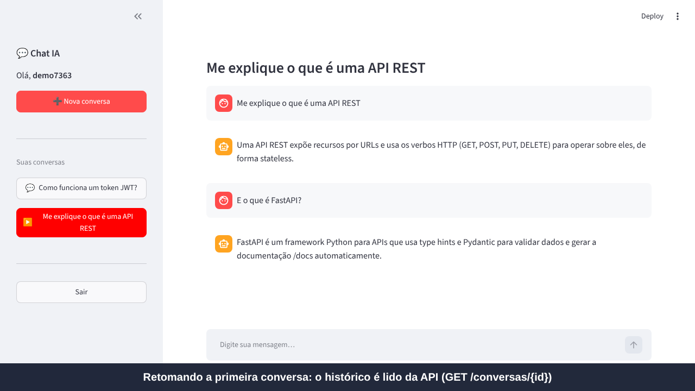

# Chat de IA Generativa com Múltiplas Conversas

Checkpoint de **Front-End em Sistemas de IA** — Tecnólogo em Inteligência Artificial (FIAP).

Interface de chat no estilo dos assistentes de IA generativa: o usuário faz login, vê a lista das suas conversas, cria uma nova, retoma uma antiga e troca mensagens de texto com um bot. O front-end (**Streamlit**) conversa **somente via HTTP (`requests`)** com uma API em **FastAPI**, que cuida de autenticação, regras de negócio e persistência (SQLite).



## Integrantes

| Nome | RM |
|------|----|
| Matheus Cardoso | 564898 |
| Caique Sousa | 563621 |
| Paulo Gabriel | 566446 |
| William Stahl | 562800 |
| Lucas Gambini | 564750 |

Turma: 2TIAPY

## Arquitetura

Dois projetos independentes (cada um com seu `requirements.txt`, `.env.example` e processo), em portas diferentes:

```
chat-ia/
├── backend/                 # FastAPI  → porta 8000
│   ├── app/
│   │   ├── main.py          # cria a FastAPI, registra routers, traduz erros de domínio em HTTP
│   │   ├── routers/         # auth.py, conversas.py, health.py (APIRouter, só validam e delegam)
│   │   ├── schemas/         # modelos Pydantic de entrada e saída
│   │   ├── services/        # regras de negócio (auth_service, conversa_service)
│   │   ├── repositories/    # acesso ao SQLite (SQL puro)
│   │   ├── llm/provider.py  # ÚNICO ponto de acesso ao modelo (simulado | gemini)
│   │   └── core/            # config (.env), segurança (JWT, hash), dependências, exceções, banco
│   ├── tests/test_api.py    # 9 testes automatizados (pytest)
│   ├── requirements.txt
│   └── .env.example
├── frontend/                # Streamlit → porta 8501
│   ├── app.py               # entrada + roteamento (st.navigation)
│   ├── pages/               # login.py, chat.py
│   ├── components/          # lista_conversas.py, mensagens.py, caixa_envio.py
│   ├── services/api_client.py  # ÚNICO módulo que chama a API (requests, timeout, erros amigáveis)
│   ├── state.py             # estado mínimo da sessão: token, usuário, conversa ativa
│   ├── requirements.txt
│   └── .env.example         # API_URL=http://localhost:8000
└── docs/                    # vídeo e imagens
```

**Fluxo:** páginas → componentes → `api_client` → API (rotas → serviços → repositórios → SQLite / provider do modelo).

Decisões principais:

- **As conversas vivem no back-end.** O front guarda apenas `token`, `username` e `conversa_id` em `st.session_state`; o histórico é sempre lido da API (`GET /conversas/{id}`).
- **Rotas sem regra de negócio:** recebem/validam com Pydantic e delegam à camada de serviço. Erros de domínio (`ConversaNaoEncontrada`, `ModeloIndisponivel` etc.) são convertidos em códigos HTTP em um único lugar (`main.py`).
- **Autenticação:** login devolve um **JWT** (HS256, expira em 120 min por padrão), exigido via `Authorization: Bearer <token>` em todas as rotas de `/conversas` e em `/auth/me`. Senhas são guardadas só como **hash PBKDF2-SHA256** com salt.
- **Autorização:** cada conversa pertence a um usuário; consultas filtram por dono, então a conversa de outro usuário responde **404** (não revela que existe).
- **Consistência:** a resposta do modelo é obtida *antes* de gravar; se o modelo falhar (503), nada fica pela metade no banco.
- **Front sem traceback:** `api_client` traduz falhas (API fora do ar, timeout, 401, 404, 409, 422, 503) em `ApiError` com mensagem amigável. Um 401 encerra a sessão e volta ao login.

### Endpoints

| Funcionalidade | Endpoint | Proteção |
|---|---|---|
| Saúde / modelo em uso | `GET /health` | pública |
| Criar conta | `POST /auth/registrar` | pública |
| Login (devolve JWT) | `POST /auth/login` | pública |
| Usuário logado | `GET /auth/me` | token |
| Listar conversas | `GET /conversas` | token |
| Nova conversa | `POST /conversas` | token |
| Abrir conversa + histórico | `GET /conversas/{id}` | token |
| Enviar mensagem | `POST /conversas/{id}/mensagens` | token |

Códigos: `200/201` sucesso · `401` sem token/token inválido/login errado · `404` conversa inexistente · `409` usuário já existe · `422` requisição inválida (Pydantic) · `503` modelo indisponível. Documentação interativa em **http://localhost:8000/docs**.

## Modelo de linguagem

O foco do checkpoint é a engenharia, não o bot. Por padrão usa o provider **simulado** (respostas por regras de palavra-chave, com eco como fallback), que **não precisa de chave nem internet**.

Opcionalmente, a **API gratuita do Gemini** pode ser ligada só pelo `.env` (`LLM_PROVIDER=gemini` + `GEMINI_API_KEY`), sem mudar rotas nem front. Se a chave faltar, o limite gratuito for atingido ou a rede cair, a API responde **503** com mensagem que o front exibe. Os limites de uso da camada gratuita são definidos pelo Google e podem mudar (consulte https://ai.google.dev/pricing).

## Pacotes necessários

- **Python 3.10+**
- Back-end: `fastapi`, `uvicorn[standard]`, `pydantic`, `PyJWT`, `python-multipart`, `python-dotenv`, `requests` (+ `pytest`, `httpx` para os testes)
- Front-end: `streamlit`, `requests`, `python-dotenv`

## Como rodar localmente (passo a passo)

Abra **dois terminais**, a partir da pasta raiz do repositório.

### 1) Back-end (terminal 1)

```bash
cd backend
python -m venv .venv
# Windows:      .venv\Scripts\activate
# Linux / Mac:  source .venv/bin/activate
pip install -r requirements.txt
cp .env.example .env          # Windows: copy .env.example .env
uvicorn app.main:app --port 8000
```

Teste: abra http://localhost:8000/health → `{"status":"ok","provedor":"simulado"}`. O arquivo `chat.db` é criado automaticamente.

### 2) Front-end (terminal 2)

```bash
cd frontend
python -m venv .venv
# Windows:      .venv\Scripts\activate
# Linux / Mac:  source .venv/bin/activate
pip install -r requirements.txt
cp .env.example .env          # Windows: copy .env.example .env
streamlit run app.py --server.port 8501
```

Abra http://localhost:8501, clique em **Criar conta**, e use **➕ Nova conversa**.

### 3) Testes automatizados (opcional)

```bash
cd backend
python -m pytest -q
```

Cobrem: rotas protegidas (401), login inválido, usuário duplicado, hash de senha, fluxo completo de conversa, 404/422, isolamento entre usuários, 503 sem gravar dados e persistência após reiniciar a API.

### Usando o Gemini (opcional)

No `backend/.env`:

```
LLM_PROVIDER=gemini
GEMINI_API_KEY=sua-chave
```

Reinicie a API. A chave nunca é versionada (`.env` está no `.gitignore`).

## Segurança e configuração

- `.env` fica fora do repositório; cada projeto traz um `.env.example` documentado.
- Troque `JWT_SECRET` por um valor aleatório (`python -c "import secrets; print(secrets.token_hex(32))"`).
- Nenhuma chave ou senha é versionada.
